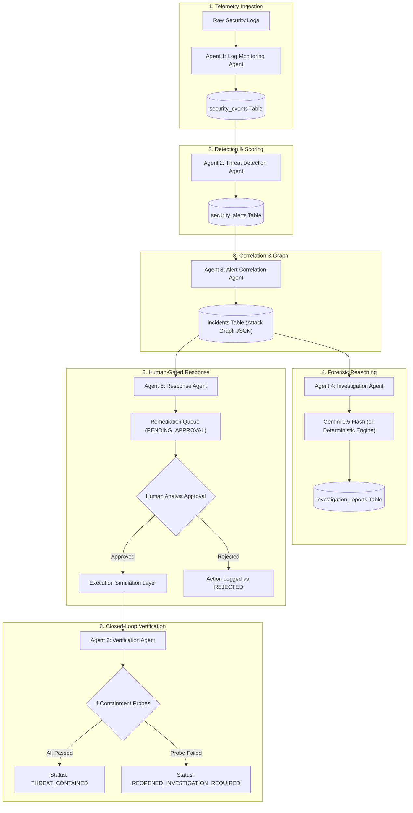
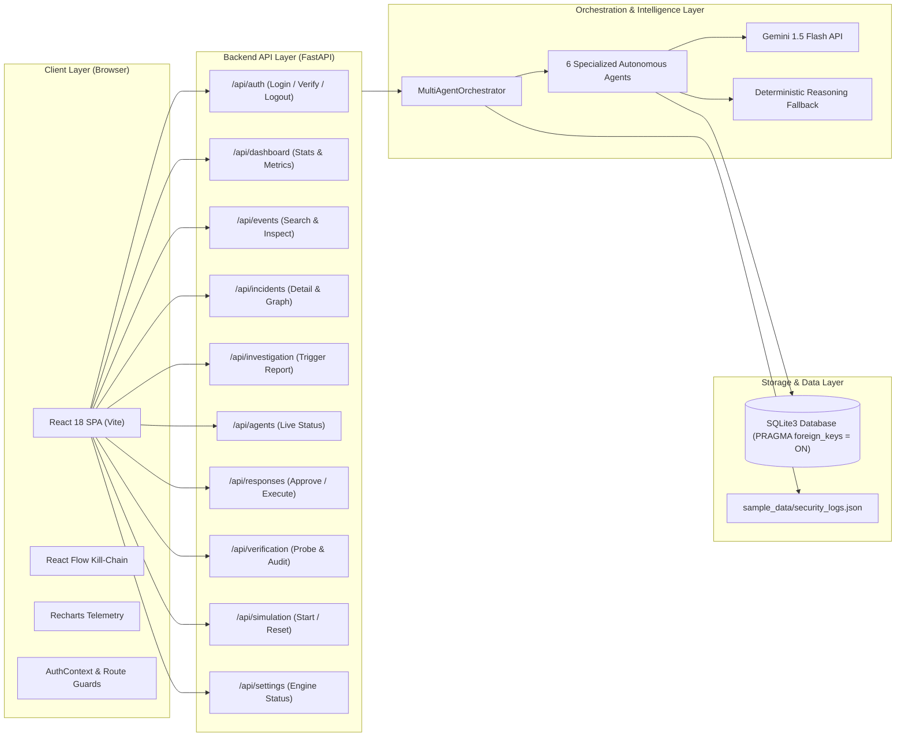

# SENTINEL AI
### Autonomous Cyber Threat Investigation & Response Platform
**"From Alert to Verified Resolution"**

[](https://github.com)
[](https://www.python.org/)
[](https://fastapi.tiangolo.com/)
[](https://react.dev/)
[](https://reactflow.dev/)
[-22C55E?style=flat-square)](backend/tests/test_sentinel.py)
[-22C55E?style=flat-square)](https://github.com)

---

## 1. Project Overview

Modern Security Operations Centers (SOCs) face an overwhelming volume of disconnected security alerts every day. Analysts frequently experience alert fatigue, manually cross-referencing IP addresses, analyzing timestamps across disparate log systems, and attempting to discern whether isolated alerts form part of a coordinated cyber attack.

**SENTINEL AI** is an autonomous cybersecurity investigation and response platform engineered to streamline security alert triage. Instead of treating alerts in isolation or generating speculative AI summaries, SENTINEL AI coordinates six specialized autonomous agents that execute the full cybersecurity triage lifecycle:

$$\text{DETECT} \longrightarrow \text{CORRELATE} \longrightarrow \text{INVESTIGATE} \longrightarrow \text{RESPOND} \longrightarrow \text{VERIFY}$$

The platform ingests heterogeneous security telemetry, detects threat indicators, correlates related alerts across shared entities, reconstructs the complete attack kill-chain in an interactive visual graph, produces evidence-backed investigation findings, enforces human authorization for sensitive remediation, and actively verifies threat containment.

---

## 2. Problem Statement

Enterprise security operations face several systemic challenges during alert triage:

1. **Fragmented Telemetry**: Security events originate from disparate endpoints, network gateways, authentication providers, and SIEM tools without unified schemas.
2. **Missing Attack Context**: A single alert (such as a failed login) rarely conveys the full threat picture until correlated with subsequent anomalous activities (such as unfamiliar IP logins or data exfiltration).
3. **Analyst Fatigue & Slow Triage**: Manually querying logs, mapping MITRE ATT&CK techniques, and reconstructing attack timelines consumes critical hours while an adversary maintains access.
4. **Unverifiable AI Summaries**: General-purpose LLM chatbots can hallucinate threat narratives that lack audit trails or ground-truth evidence.
5. **Operational Risk in Remediation**: Automated response systems risk disrupting mission-critical business systems if destructive actions are executed without human oversight.
6. **Lack of Containment Verification**: Traditional tools stop after issuing a recommendation or running a containment script, leaving security teams uncertain whether the threat has actually been neutralized or persists via secondary channels.

---

## 3. Our Solution

SENTINEL AI solves these challenges by unifying the triage lifecycle into an evidence-driven, multi-agent architecture:

* **Centralized Telemetry Ingestion**: Ingests and normalizes raw event schemas into standardized, queryable security events.
* **Heuristic & Rule-Based Detection**: Evaluates events against deterministic rules and scoring models, mapping alerts directly to MITRE ATT&CK techniques.
* **Entity-Based Correlation**: Discovers hidden relationships across user accounts, source IP addresses, devices, and session identifiers to assemble multi-stage incidents.
* **Interactive Kill-Chain Reconstruction**: Renders the complete cross-alert attack progression as an interactive directed graph powered by React Flow.
* **Evidence-First Investigation**: Enforces cryptographic traceability: every AI finding explicitly cites the exact event IDs that substantiate it.
* **Human-in-the-Loop Remediation**: Formulates targeted response recommendations, but strictly gates execution behind explicit human authorization.
* **Closed-Loop Containment Verification**: Actively tests endpoint session validity, firewall packet drops, process termination, and socket states to confirm containment. If any verification probe detects ongoing adversary activity, the incident is automatically reopened.

---

## 4. Key Capabilities

### 1. Intelligent Security Monitoring
Continuous ingestion, normalization, and parsing of enterprise security events (authentication, process execution, file access, network flows, and DNS queries). Each event is parsed into a standardized schema capturing timestamps, network entities, user principals, accessed resources, execution status, and severity classifications.

### 2. Threat Detection and Risk Scoring
Deterministic threat detection rules identify suspicious behavior patterns including rapid failed login bursts (brute-force), geographic anomalies (impossible travel), unauthorized access to restricted shares, obfuscated PowerShell execution, and encrypted data exfiltration bursts. Alerts receive composite risk scores (0–100) and MITRE ATT&CK technique tags.

### 3. Cross-Alert Attack Reconstruction
Independent alerts sharing common entities (e.g., username `sarah.connor`, IP `198.51.100.42`, or session ID `SESSION-TK-9921`) are clustered into unified security incidents. The platform reconstructs the adversary's operational kill-chain as an interactive React Flow graph, visualizing initial access, credential compromise, privilege escalation, lateral movement, and data exfiltration.

### 4. Evidence-First Investigation
The Investigation Agent synthesizes comprehensive incident reports where **zero unbacked claims** are permitted. Every forensic finding links directly to the concrete log event IDs that substantiate it. Analysts can click any evidence token to inspect raw timestamps, payload parameters, decoded command strings, and normalized telemetry.

### 5. Human-in-the-Loop Response
Remediation recommendations (session revocation, perimeter firewall blocks, credential reset, and host isolation) are queued in the Response Center. Destructive or disruptive commands require explicit human authorization. Analysts review operational impact justifications and can approve or reject actions before execution. Approved actions are executed through a safe simulation layer that logs simulated latency, target systems, and audit records.

### 6. Closed-Loop Threat Verification
Unlike systems that assume remediation succeeded, the Verification Agent executes post-response validation probes:
* **Session Invalidation Check**: Verifies that revoked tokens return HTTP 401 Unauthorized across all service gateways.
* **Perimeter Drop Check**: Validates that edge firewalls are actively dropping packets from adversary IP addresses.
* **Endpoint Telemetry Probe**: Confirms the termination of unauthorized process trees.
* **Network Socket Audit**: Verifies that outbound C2 communication channels have ceased.

If verification confirms containment, the incident status transitions to `THREAT_CONTAINED`. If any probe fails, the incident is immediately **reopened** (`REOPENED_INVESTIGATION_REQUIRED`) with an escalation alert.

### 7. Centralized SOC Dashboard
A high-contrast, enterprise dark-themed operations dashboard displaying key performance indicators (Total Events, Active Incidents, Critical Threats, Resolved Incidents, Pending Approvals), telemetry volume over time, threat severity distributions, recent activity feeds, and active agent execution status.

### 8. Agent Execution Monitoring
Real-time visibility into the operational state of all six specialized agents, displaying live operational status (`IDLE`, `PROCESSING`, `SUCCESS`), current task descriptions, event throughput counters, execution latency (in milliseconds), and latest output telemetry.

---

## 5. Multi-Agent Architecture

SENTINEL AI employs a modular multi-agent orchestration architecture written in Python without heavy or opaque frameworks. Agents communicate through a shared relational state layer and orchestrator pipeline.



### Detailed Agent Breakdown

| Agent | Module | Primary Responsibility | Ground-Truth Output |
| :--- | :--- | :--- | :--- |
| **Agent 1: Log Monitoring Agent** | `backend.agents.monitoring` | Ingests, validates, and normalizes heterogeneous event formats into standardized schemas. Flags suspicious keywords and failed operations. | Normalized `security_events` records with normalized IP, user, device, and status fields. |
| **Agent 2: Threat Detection Agent** | `backend.agents.detection` | Applies deterministic detection rules and heuristics against normalized events. Computes risk scores (0–100) and maps MITRE ATT&CK techniques. | Structured `security_alerts` citing source event IDs and MITRE IDs (T1110, T1078, T1083, T1059.001, T1041). |
| **Agent 3: Alert Correlation Agent** | `backend.agents.correlation` | Analyzes entity overlaps (shared IP, username, device ID, session token) and temporal proximity to link disparate alerts into multi-stage attack graphs. | Unified `incidents` records containing React Flow compatible node and edge graph data. |
| **Agent 4: Investigation Agent** | `backend.agents.investigation` | Performs deep forensic analysis. Uses Google Gemini 1.5 Flash (or built-in deterministic fallback) to generate an evidence-first report where every claim cites specific log IDs. | `investigation_reports` with composite severity, confidence scores, chronological timeline, and evidence-mapped findings. |
| **Agent 5: Response Agent** | `backend.agents.response` | Formulates targeted remediation actions. Enforces human approval, tracks justification notes, and executes approved actions in a safe simulation harness. | `response_actions` transitioning through `PENDING_APPROVAL` $\to$ `APPROVED` $\to$ `EXECUTED`. |
| **Agent 6: Verification Agent** | `backend.agents.verification` | Performs 4 automated post-remediation probes. Confirms threat containment or triggers automated incident reopening upon failure. | `verification_records` with detailed check logs, updating incident status to `THREAT_CONTAINED` or `REOPENED_INVESTIGATION_REQUIRED`. |

---

## 6. System Architecture



---

## 7. Technology Stack

### Frontend
* **Core Framework**: React 18.3.1
* **Build Tool**: Vite 5.4.2
* **Routing**: React Router DOM 6.26.0
* **Attack Graph Visualization**: React Flow (`reactflow` 11.11.4)
* **Metrics & Charts**: Recharts 2.12.7
* **Icons**: Lucide React 0.441.0
* **Styling**: Tailwind CSS 3.4.10 with custom dark theme palette (`#080D18`, `#0D1422`, `#141E2E`, `#192538`, `#1E2B42`, `#38BDF8`)
* **Utilities**: `clsx`, `tailwind-merge`

### Backend
* **Runtime**: Python 3.10+ (tested and verified on Python 3.14.7)
* **Web Framework**: FastAPI 0.110.0+
* **ASGI Server**: Uvicorn 0.28.0+
* **Data Validation**: Pydantic v2 (2.6.0+)
* **Form & Auth Parsing**: `python-multipart` 0.0.9+
* **HTTP Client**: Requests 2.31.0+

### Database
* **Database Engine**: Relational SQLite3 (`PRAGMA foreign_keys = ON`)
* **Driver**: Python built-in `sqlite3` with thread-safe connection pooling and row factories

### AI & Reasoning Engine
* **Primary AI**: Google Gemini 1.5 Flash API (via direct REST client)
* **Fallback AI**: Built-in deterministic threat intelligence engine (100% functionality without requiring external API keys)

### Testing & Development
* **Test Runner**: Pytest 8.0.0+ / 9.1.1
* **Asynchronous Testing**: `anyio` 4.14.2

---

## 8. Application Screenshots

Screenshots are organized in the [`docs/screenshots/`](docs/screenshots/) directory.

| View | Screenshot | Description |
| :--- | :--- | :--- |
| **Dedicated Login Page** |  | Professional two-column desktop authentication view with branding, security overview, and one-click demo credentials. |
| **Main SOC Dashboard** |  | High-contrast overview displaying live event volume, threat distribution, active incident metrics, and recent telemetry feed. |
| **Live Threat Monitoring** |  | Real-time event stream with multi-field search, severity filters, and raw JSON payload inspection. |
| **Incident Management** |  | Correlated security incidents organized by risk score, primary entity, MITRE techniques, and containment status. |
| **Attack Investigation** |  | Interactive React Flow attack kill-chain graph, evidence-first findings citing concrete log IDs, and chronological timeline. |
| **AI Agent Activity** |  | Real-time operational status, execution metrics, event throughput, and latency counters for all 6 agents. |
| **Response Center** |  | Human-in-the-loop remediation queue with approval/rejection workflows and safe execution simulation. |
| **Verification Center** |  | Closed-loop verification records, 4 automated containment checks, and interactive failure simulation probe. |
| **Platform Settings** |  | Live Gemini AI engine status, deterministic fallback toggle, database table metrics, and threat feed configurations. |

> **Note**: Screenshot image assets can be saved to [`docs/screenshots/`](docs/screenshots/) following the naming conventions listed above.

---

## 9. End-to-End Demonstration Scenario

The platform includes a built-in multi-stage security scenario modeling an **Employee Account Compromise & Data Exfiltration** attack against corporate infrastructure:

```
[10:02 UTC] EVT-2026-1002: 15 Failed Logins (Brute Force)
     │
     ▼
[10:05 UTC] EVT-2026-1003: Successful Login from Unfamiliar Romanian IP (Credential Compromise)
     │
     ▼
[10:06 UTC] EVT-2026-1004: Impossible Travel Anomaly (Austin, TX → Bucharest, RO in 51 min)
     │
     ▼
[10:08 UTC] EVT-2026-1005: Unauthorized Recursive File Access (Executive Blueprints & Payroll)
     │
     ▼
[10:10 UTC] EVT-2026-1006: Obfuscated Hidden PowerShell Process Execution (Remote Stager)
     │
     ▼
[10:12 UTC] EVT-2026-1007: 50MB Encrypted Outbound Data Burst to Adversary C2 IP (Exfiltration)
```

### Detailed Event Telemetry:

| Event ID | Time (UTC) | Action | Technique | Details |
| :--- | :--- | :--- | :--- | :--- |
| `EVT-2026-1002` | 10:02:00 | `FAILED_LOGIN_BURST` | T1110.001 | 15 rapid consecutive failed logins targeting user `sarah.connor` from external IP `198.51.100.42`. |
| `EVT-2026-1003` | 10:05:12 | `SUCCESSFUL_LOGIN` | T1078.002 | Valid password login immediately following brute-force from unfamiliar ASN AS9009 (Bucharest, RO). |
| `EVT-2026-1004` | 10:06:40 | `IMPOSSIBLE_TRAVEL_LOGIN` | T1078 | Authentication from Bucharest, RO 51 minutes after prior valid session in Austin, TX (9,480 km). |
| `EVT-2026-1005` | 10:08:22 | `UNUSUAL_FILE_ACCESS` | T1083 | Bulk recursive read of restricted executive salary audits and encryption blueprints from QA user account. |
| `EVT-2026-1006` | 10:10:05 | `SUSPICIOUS_COMMAND_EXECUTION` | T1059.001 | Base64-encoded hidden PowerShell command invoking remote WebClient stager from `203.0.113.199`. |
| `EVT-2026-1007` | 10:12:30 | `DATA_EXFILTRATION_BURST` | T1041 | 50 MB encrypted outbound stream burst to external threat C2 IP `203.0.113.199:8443` within 15 seconds. |

### Multi-Agent Lifecycle Execution:
1. **Agent 1 (Monitoring)** parses the raw JSON telemetry, validates fields, and records normalized events into `security_events`.
2. **Agent 2 (Detection)** flags failed login bursts, impossible travel, unauthorized file reads, hidden PowerShell scripts, and outbound traffic bursts, generating structured alerts.
3. **Agent 3 (Correlation)** identifies that all alerts involve principal `sarah.connor`, IP `198.51.100.42`, and session `SESSION-TK-9921`, clustering them into Incident `INC-2026-0881` and generating the React Flow graph.
4. **Agent 4 (Investigation)** builds an evidence-first report with a 96% confidence score, citing `EVT-2026-1002` through `EVT-2026-1007`.
5. **Agent 5 (Response)** queues four targeted response recommendations:
   * Revoke Active User Session (`ACT-REVOKE-SESSION`) — Risk: HIGH
   * Block Adversary IP on Perimeter Firewall (`ACT-BLOCK-IP`) — Risk: MEDIUM
   * Reset Compromised Credentials & Quarantine Account (`ACT-QUARANTINE-ACCT`) — Risk: HIGH
   * Isolate Compromised Host from Subnet (`ACT-ISOLATE-HOST`) — Risk: CRITICAL
6. **Human Analyst** reviews the queue and approves the session revocation action.
7. **Agent 5** simulates safe execution, recording latency and audit log output.
8. **Agent 6 (Verification)** executes four automated checks:
   * Session Invalidation Check: **PASSED** (HTTP 401 verified)
   * Firewall Drop Check: **PASSED** (Packet drop rate 100%)
   * Host Process Termination Check: **PASSED** (Process ID terminated)
   * Network Socket Audit: **PASSED** (Socket closed)
   The incident is verified and marked **`THREAT_CONTAINED`**.
9. **Interactive Failure Test**: If the analyst clicks **"Simulate Failed Verification"**, Agent 6 simulates persistent adversary activity, immediately marking verification as **`VERIFICATION_FAILED`** and reopening the incident to **`REOPENED_INVESTIGATION_REQUIRED`**.

---

## 10. Installation and Setup

### Prerequisites
* **Python**: Version 3.10 or higher (tested on Python 3.10, 3.11, and 3.14)
* **Node.js**: Version 18.0 or higher
* **npm**: Version 9.0 or higher
* **Git**: Installed and configured

### Step 1: Clone Repository
```bash
git clone https://github.com/your-username/sentinel-ai-cyber-triage-agent.git
cd sentinel-ai-cyber-triage-agent
```

### Step 2: Backend Setup

#### On Windows (PowerShell):
```powershell
# Create Python virtual environment
python -m venv venv

# Activate virtual environment
.\venv\Scripts\Activate.ps1

# Install backend dependencies
pip install -r backend/requirements.txt

# (Optional) Copy environment configuration
Copy-Item .env.example .env

# Start FastAPI backend server
python -m uvicorn backend.main:app --host 127.0.0.1 --port 8000 --reload
```

#### On Linux / macOS:
```bash
# Create Python virtual environment
python3 -m venv venv

# Activate virtual environment
source venv/bin/activate

# Install backend dependencies
pip install -r backend/requirements.txt

# (Optional) Copy environment configuration
cp .env.example .env

# Start FastAPI backend server
python3 -m uvicorn backend.main:app --host 127.0.0.1 --port 8000 --reload
```

The backend server will start at: **`http://127.0.0.1:8000`**  
Interactive Swagger API documentation: **`http://127.0.0.1:8000/docs`**

### Step 3: Frontend Setup

Open a separate terminal window:

```bash
# Navigate to the frontend directory
cd frontend

# Install frontend dependencies
npm install

# Start Vite development server
npm run dev
```

The frontend application will start at: **`http://localhost:5173`**

### Step 4: Demo Credentials

Access `http://localhost:5173` in your browser. You will be greeted by the dedicated login page. Use either authorized demo account (or click the one-click **Demo Login** buttons on the form):

| Role | Email | Password | Clearance Level |
| :--- | :--- | :--- | :--- |
| **Senior SOC Lead Analyst** | `analyst@sentinel.cyber` | `Sentinel@2026!` | Level 4 (Top Secret / SCI) |
| **SecOps Director** | `admin@sentinel.cyber` | `SentinelAdmin#1` | Level 5 (Directorate Access) |

---

## 11. Environment Variables

Configuration settings are loaded via environment variables or a `.env` file at the repository root. A template is provided in [`.env.example`](.env.example):

| Variable | Default Value | Description | Required? |
| :--- | :--- | :--- | :--- |
| `HOST` | `127.0.0.1` | Host interface for FastAPI ASGI server. | Optional |
| `PORT` | `8000` | Port for FastAPI ASGI server. | Optional |
| `ENVIRONMENT` | `development` | Deployment environment identifier (`development` / `production`). | Optional |
| `GEMINI_API_KEY` | `""` (Empty string) | Google Gemini API key for live LLM reasoning in the Investigation Agent. | **Optional** |
| `GEMINI_MODEL` | `gemini-1.5-flash` | Gemini model identifier used for threat synthesis. | Optional |
| `VIRUSTOTAL_API_KEY`| `""` (Empty string) | VirusTotal API key for IP and hash reputation queries. | Optional |
| `ABUSEIPDB_API_KEY` | `""` (Empty string) | AbuseIPDB API key for IP threat scoring queries. | Optional |
| `DATABASE_PATH` | `sentinel.db` | Local SQLite database file location. | Optional |

> **Zero-Failure Fallback Guarantee**: If `GEMINI_API_KEY` is omitted or invalid, SENTINEL AI automatically runs on its built-in **Deterministic Threat Engine**. The platform never halts, crashes, or produces simulated deception due to missing API keys.

---

## 12. API Documentation

SENTINEL AI exposes a modular REST API structured across ten resource routers:

### Authentication Endpoints (`/api/auth`)
* `POST /api/auth/login`: Authenticates user credentials and returns a bearer session token.
  * *Request Body*: `{"email": "string", "password": "string", "remember_me": false}`
* `GET /api/auth/verify`: Validates an active bearer token against the active session store.
  * *Headers*: `Authorization: Bearer <token>`
* `POST /api/auth/logout`: Invalidates the session token.

### Dashboard Endpoints (`/api/dashboard`)
* `GET /api/dashboard/stats`: Returns aggregated SOC KPI counts, event volume over time, threat severity distributions, and recent telemetry activity.

### Security Events Endpoints (`/api/events`)
* `GET /api/events`: Queries normalized security events.
  * *Query Parameters*: `severity` (e.g., `CRITICAL`, `HIGH`, `ALL`), `event_type`, `search` (keyword search across IP, username, resource), `limit` (default: 100).
* `GET /api/events/{event_id}`: Retrieves an exact event record by its primary key ID (e.g., `EVT-2026-1002`).
* `POST /api/events`: Ingests one or more raw security event objects.

### Security Incidents Endpoints (`/api/incidents`)
* `GET /api/incidents`: Returns summary cards for all correlated attack incidents.
* `GET /api/incidents/{incident_id}`: Retrieves complete incident details, including associated alerts, investigation report, and React Flow attack graph JSON (`nodes` and `edges`).

### Investigation Endpoints (`/api/investigation`)
* `POST /api/investigation/{incident_id}`: Triggers the Investigation Agent to perform deep forensic reasoning and generate an evidence-first investigation report citing concrete log event IDs.

### Agent Operations Endpoints (`/api/agents`)
* `GET /api/agents/status`: Returns the operational status (`IDLE`, `PROCESSING`, `SUCCESS`), current task, processed event count, latest output telemetry, and execution latency for all six agents.

### Remediation & Response Endpoints (`/api/responses`)
* `GET /api/responses`: Returns all formulated remediation action recommendations.
* `POST /api/responses/{response_id}/approve`: Approves a pending action.
  * *Request Body*: `{"decision_by": "SOC Lead Analyst"}`
* `POST /api/responses/{response_id}/reject`: Rejects a pending action with required justification.
  * *Request Body*: `{"decision_by": "SOC Lead Analyst", "rejection_reason": "string"}`
* `POST /api/responses/{response_id}/execute`: Executes an approved action in safe simulation, generating execution audit telemetry and latency metrics.

### Verification Endpoints (`/api/verification`)
* `GET /api/verification`: Returns audit history of all closed-loop verification records.
* `POST /api/verification/{response_id}`: Executes the 4-probe containment verification check.
  * *Request Body*: `{"simulate_failure": false, "analyst_notes": "string"}`

### Simulation Endpoints (`/api/simulation`)
* `POST /api/simulation/start`: Executes the complete multi-agent pipeline on the built-in Employee Account Compromise attack scenario.
* `POST /api/simulation/reset`: Resets all database tables and agent states to a clean initial baseline.

### System Settings Endpoints (`/api/settings`)
* `GET /api/settings/status`: Reports backend infrastructure health, Gemini live AI vs. deterministic fallback state, SQLite table record counts, and external threat intel status.

---

## 13. Project Structure

```
sentinel-ai-cyber-triage-agent/
├── .env.example                     # Environment configuration template
├── .gitignore                       # Clean Git exclusion rules (<10MB protected)
├── README.md                        # Comprehensive platform documentation
├── sample_data/
│   └── security_logs.json           # Realistic multi-stage attack scenario telemetry
├── docs/
│   └── screenshots/
│       └── README.md                # UI walkthrough asset guidelines
├── backend/
│   ├── config.py                    # Pydantic environment configuration
│   ├── main.py                      # FastAPI application entry point & router mounting
│   ├── requirements.txt             # Python backend dependencies
│   ├── database/
│   │   └── db.py                    # SQLite schema initialization & connection context
│   ├── schemas/
│   │   └── schemas.py               # Pydantic request & response data models
│   ├── services/
│   │   ├── gemini_service.py        # Google Gemini 1.5 Flash client & deterministic fallback
│   │   └── orchestrator.py          # 6-agent sequential pipeline coordinator
│   ├── agents/
│   │   ├── __init__.py              # Central agent registry
│   │   ├── base.py                  # Abstract base agent with telemetry state sync
│   │   ├── monitoring.py            # Agent 1: Log Monitoring Agent
│   │   ├── detection.py             # Agent 2: Threat Detection Agent
│   │   ├── correlation.py           # Agent 3: Alert Correlation Agent & Graph Builder
│   │   ├── investigation.py         # Agent 4: Evidence-First Investigation Agent
│   │   ├── response.py              # Agent 5: Response Recommendation & Approval Agent
│   │   └── verification.py          # Agent 6: Closed-Loop Containment Verification Agent
│   ├── routes/
│   │   ├── auth.py                  # Authentication & session token management
│   │   ├── dashboard.py             # SOC dashboard metrics & volume queries
│   │   ├── events.py                # Security event search & primary key inspection
│   │   ├── incidents.py             # Correlated incident & attack graph queries
│   │   ├── investigation.py         # Investigation report generation endpoint
│   │   ├── agents.py                # Real-time agent status & telemetry metrics
│   │   ├── responses.py             # Remediation approval, rejection & simulation
│   │   ├── verification.py          # Containment verification & reopening endpoint
│   │   ├── simulation.py            # Scenario execution & database reset endpoints
│   │   └── settings.py              # Platform status & database record counters
│   └── tests/
│       └── test_sentinel.py         # 12 automated unit & integration test cases
└── frontend/
    ├── index.html                   # HTML entry point with metadata & fonts
    ├── package.json                 # Node.js dependencies & scripts
    ├── vite.config.js               # Vite build & development proxy configuration
    ├── tailwind.config.js           # Custom enterprise dark SOC theme definitions
    ├── postcss.config.js            # PostCSS configuration
    └── src/
        ├── App.jsx                  # Main application router & route guarding
        ├── index.css                # Global styles, scrollbars, and Tailwind directives
        ├── main.jsx                 # React DOM mount point
        ├── context/
        │   ├── AuthContext.jsx      # Authentication session & token context
        │   └── SentinelContext.jsx  # Global notification & data refresh context
        ├── services/
        │   └── api.js               # Centralized fetch API client with auth bearer injection
        ├── components/
        │   ├── Navbar.jsx           # SOC header with scenario triggers & user profile
        │   ├── Sidebar.jsx          # Collapsible navigation sidebar with status badges
        │   ├── ProtectedRoute.jsx   # Client-side route protection guard
        │   ├── MetricCard.jsx       # Non-truncated KPI metric card component
        │   ├── AttackGraph.jsx      # Interactive React Flow kill-chain visualizer
        │   ├── EvidenceViewerModal.jsx # Forensic log inspector modal
        │   ├── AgentPipelineVisualizer.jsx # 6-stage pipeline progress indicator
        │   └── StatusBadge.jsx      # Semantic status, severity, and risk badges
        └── pages/
            ├── LoginPage.jsx        # Two-column enterprise authentication page
            ├── DashboardPage.jsx    # Primary SOC operations dashboard
            ├── LiveMonitoringPage.jsx # Real-time log telemetry feed & search
            ├── IncidentManagementPage.jsx # Correlated security incidents registry
            ├── AttackInvestigationPage.jsx # Evidence findings & attack graph explorer
            ├── AgentActivityPage.jsx # 6-agent real-time status & latency monitor
            ├── ResponseCenterPage.jsx # Remediation queue with approval gates
            ├── VerificationCenterPage.jsx # Containment audit log & failure simulation
            └── SettingsPage.jsx     # Platform engine health & database records
```

---

## 14. Security and Reliability

* **Human-in-the-Loop Safety**: Sensitive remediation commands (such as network boundary IP blocking or host network isolation) are never executed automatically. They require explicit analyst review and authorization.
* **Safe Simulation Execution**: Remediation actions in this prototype are executed through an isolated simulation harness that models latency, records execution audit trails, and tests endpoint checks without modifying real-world operating system network configurations.
* **Authentication Prototype Architecture**: The platform provides a token-based authentication mechanism (`stnl_` bearer tokens) with session validation and route guarding. In enterprise production, this would be wired to SAML 2.0 / OIDC identity providers with hardware multi-factor authentication (MFA).
* **Environment Variable Isolation**: API keys and secrets are stored strictly on the backend via environment variables and are never surfaced to client browser code.
* **Deterministic Fallback Engine**: If the Gemini API key is unset or external network access is blocked, the platform seamlessly engages its deterministic reasoning engine. It produces fully structured investigation reports, attack graphs, and remediation options with zero downtime.
* **SQL Injection Prevention**: All SQLite queries utilize parameterized query bindings (`?` placeholders) and enforce relational integrity via `PRAGMA foreign_keys = ON`.

---

## 15. Testing and Validation

SENTINEL AI includes 12 automated unit and integration tests covering the complete multi-agent triage lifecycle:

```bash
# Execute backend test suite from repository root
pytest backend/tests/test_sentinel.py -v
```

### Verified Test Results:
```text
============================= test session starts =============================
platform win32 -- Python 3.14.7, pytest-9.1.1, pluggy-1.6.0
rootdir: C:\Users\HP\OneDrive\Desktop\sentinel-ai-cyber-triage-agent
plugins: anyio-4.14.2
collected 12 items

backend/tests/test_sentinel.py::test_settings_status PASSED              [  8%]
backend/tests/test_sentinel.py::test_log_monitoring_normalization PASSED [ 16%]
backend/tests/test_sentinel.py::test_threat_detection_rules_and_scoring PASSED [ 25%]
backend/tests/test_sentinel.py::test_alert_correlation_and_attack_graph PASSED [ 33%]
backend/tests/test_sentinel.py::test_evidence_first_investigation_report PASSED [ 41%]
backend/tests/test_sentinel.py::test_response_approval_rejection_and_simulation PASSED [ 50%]
backend/tests/test_sentinel.py::test_closed_loop_verification_success PASSED [ 58%]
backend/tests/test_sentinel.py::test_closed_loop_verification_failure_reopening PASSED [ 66%]
backend/tests/test_sentinel.py::test_all_six_agents_status PASSED        [ 75%]
backend/tests/test_sentinel.py::test_dashboard_stats_endpoint PASSED     [ 83%]
backend/tests/test_sentinel.py::test_events_filtering_and_ingestion PASSED [ 91%]
backend/tests/test_sentinel.py::test_authentication_flow PASSED          [100%]

============================= 12 passed in 25.79s =============================
```

### Frontend Build Verification:
```bash
cd frontend
npm run build
```
```text
✓ 2213 modules transformed.
dist/index.html                   1.18 kB │ gzip:   0.69 kB
dist/assets/index-Doj-Hfr3.css   44.66 kB │ gzip:   8.46 kB
dist/assets/index-vZDXvWCb.js   855.56 kB │ gzip: 239.66 kB
✓ built in 13.03s (0 errors)
```

---

## 16. Future Scope

The following capabilities represent planned architectural enhancements for future production iterations:

* **Real SIEM Integrations**: Ingestion connectors for enterprise SIEM platforms including Splunk, Elastic Security, and Wazuh.
* **Expanded Threat Intelligence Enrichment**: Live indicator scoring through integrations with AlienVault OTX, MISP, and CIRCL.
* **Advanced Machine Learning Anomaly Detection**: Unsupervised user and entity behavior analytics (UEBA) for continuous baseline drift detection.
* **Enterprise IAM & SSO**: SAML 2.0, Okta, and Azure Active Directory integration with hardware FIDO2/WebAuthn multi-factor authentication.
* **Active SOAR Integration**: Connectors to execute firewall changes directly via Palo Alto PAN-OS, Cisco ASA, and AWS Security Group APIs.
* **Distributed Agent Workers**: Fanning out agent task execution using Celery or Redis task queues for high-volume enterprise event streams.

---

## 17. Contributors & Acknowledgements

* **Developed for**: Hackathon Track **PS06 — AI-Powered Cybersecurity Triage**
* **Project Team**: SENTINEL AI Development Team
* **Contact & Inquiries**: `[Insert Team Contact / Repository Link]`

---

## 18. License

This project is licensed under the MIT License. See the [LICENSE](LICENSE) file for details.
